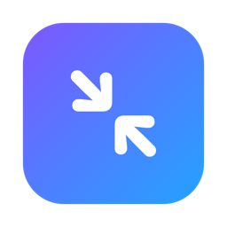
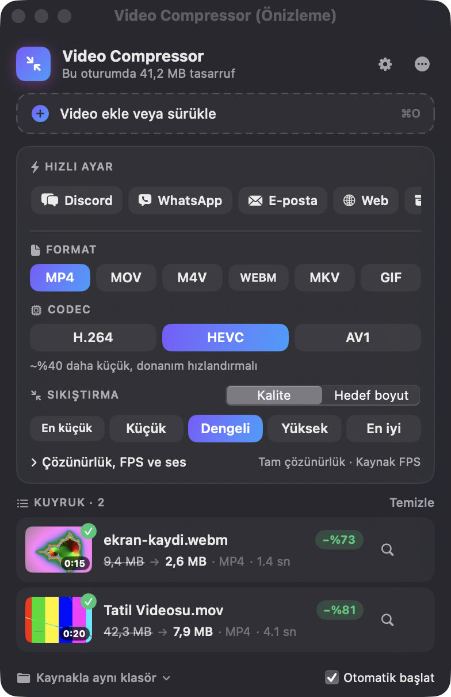

<p align="center">
  
</p>

<h1 align="center">Video Compressor</h1>

<p align="center">
  A fast, native macOS menu bar app that shrinks videos. Drag a video in and get a smaller copy back.
  <br><br>
  <a href="https://github.com/ardasnturk/video-compressor/releases/latest"><b>Download the latest release</b></a>
  ·
  <a href="CHANGELOG.md">Changelog</a>
</p>

<p align="center">
  
</p>

## Features

- **Menu bar first**: no Dock icon. Progress shows live in the menu bar while it works.
- **Drag & drop** files or whole folders, pick with ⌘O, or use *Open With → Video Compressor* in Finder.
- **Formats:** MP4, MOV, M4V, WebM, MKV, GIF.
- **Codecs:** H.264 and HEVC (hardware accelerated), AV1 and VP9.
- **Two ways to compress**
  - *Quality*: five levels from "smallest" to "best". It never uses more bitrate than the source.
  - *Target size*, e.g. "at most 10 MB". If the first pass overshoots, a corrected second pass runs automatically.
- **Presets** for Discord (10 MB), WhatsApp (16 MB), e-mail (24 MB), Web (VP9), Archive (HEVC) and GIF.
- **Fine control:** resolution limit (4K…360p, never upscales), frame-rate limit, remove audio.
- **Queue:** estimated output size, ETA, savings, cancel and retry, and parallel jobs. Drag a finished file straight into Slack, Mail or Finder.
- **Automatic updates** via [Sparkle](https://sparkle-project.org). Builds are signed with Developer ID and notarized.

> The interface is currently in **Turkish**. Translations are welcome; see [CONTRIBUTING.md](CONTRIBUTING.md).

## Install

1. Download `VideoCompressor-x.y.z.dmg` from the [latest release](https://github.com/ardasnturk/video-compressor/releases/latest).
2. Open it and drag **Video Compressor** into **Applications**.
3. Launch it. The icon appears in the menu bar.

Requires macOS 14 Sonoma or later, on Apple Silicon or Intel.

### Optional: ffmpeg

MP4, MOV and M4V output with H.264 or HEVC uses Apple's built-in AVFoundation / VideoToolbox and needs nothing else.
WebM, MKV, GIF, AV1, VP9 and sources macOS can't read on its own (such as `.webm`, `.mkv` and `.avi`) use your local ffmpeg:

```bash
brew install ffmpeg
```

Video Compressor finds ffmpeg in `/opt/homebrew/bin`, `/usr/local/bin` and `/opt/local/bin`. You can also set a custom folder in Preferences.

## How it works

| Engine | Used for | Dependency |
|---|---|---|
| AVFoundation + VideoToolbox | MP4 / MOV / M4V with H.264 / HEVC | none (built in) |
| ffmpeg | WebM, MKV, GIF, AV1, VP9, and inputs AVFoundation can't decode | `brew install ffmpeg` |

Bitrates are computed from bits-per-pixel × resolution × frame rate and scaled by codec efficiency.
They are capped at the source's own bitrate, so an already-small video doesn't grow.
In target-size mode the bitrate comes from the size budget and the duration.

## Build from source

```bash
git clone https://github.com/ardasnturk/video-compressor.git
cd video-compressor
swift test                          # end-to-end encode tests (needs ffmpeg)
./scripts/build-app.sh --install    # ad-hoc signed app → /Applications
```

```
Sources/VideoCompressor/
  App/        App entry (MenuBarExtra, preferences window, AppDelegate)
  Models/     CompressionSettings + presets, VideoInfo + EncodePlan, CompressionJob
  Services/   JobQueue, AVFoundationEngine, FFmpegEngine, VideoProbe, UpdateController, AppSettings
  Views/      MenuContentView, SettingsPanelView, DropZoneView, JobRowView, PreferencesView
scripts/      build-app.sh (bundle + sign), release.sh (notarize, DMG, appcast, GitHub release)
```

## Contributing

Issues and pull requests are welcome. Read [CONTRIBUTING.md](CONTRIBUTING.md) first.

## License

[MIT](LICENSE) © 2026 Arda Sentürk.

Video Compressor bundles [Sparkle](https://github.com/sparkle-project/Sparkle) (MIT license).
ffmpeg is **not** bundled. When it is installed, it runs as a separate process under its own license.
